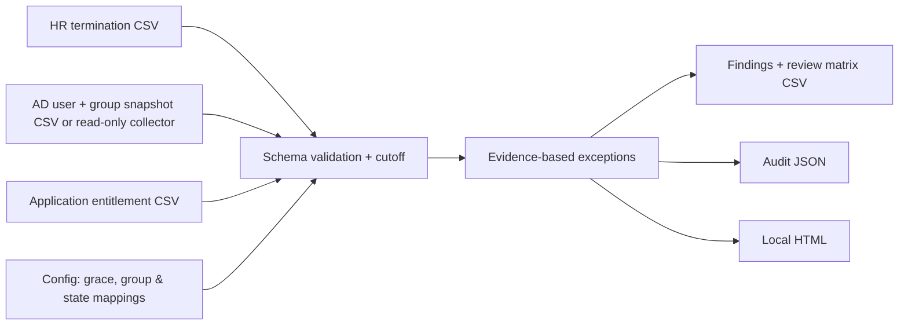

# Design and trust boundaries

## Inputs and flow

The evaluator is a pure, deterministic read-only decision layer given a timestamp and input snapshots. Runtime reports are written locally. There is no database, API server, credential storage, cloud telemetry, or automatic account mutation.

## Source of truth and correlation

1. HR provides termination state and effective time. Only `Terminated` rows with an effective timestamp older than the grace threshold are checked. A scheduled or not-yet-due record is not an exception.
2. AD account lookup uses the HR `SamAccountName`. AD `EmployeeId` must agree with HR for confidence in correlation; mismatch is flagged.
3. App exports match HR `EmployeeId`. Application owner controls the meaning of app entitlement state and privileged flag; no automatic inference from username similarity.
4. An AD account not found in a queried domain is an evidence gap, **not** proof of successful deprovisioning. An absent app row for a required application is also an evidence gap, not proof an account never existed.
5. Group enumerations have a declared `GroupEvidenceComplete` flag, reflecting that collection succeeded in the queried context; this does not certify every forest, tenant, nested group relationship, or downstream resource.

## Failure behavior

- Unknown timestamps, duplicate identity keys, unsupported HR statuses, malformed booleans, or invalid configuration abort analysis rather than silently dropping records.
- Domain connectivity and authorization errors abort an AD scan. Missing AD identity returns `Found=False` where the AD cmdlet reports a true not-found result.
- A failed AD group membership query marks group collection incomplete and emits an audit gap; the verifier does not pretend the group list is empty.
- Stale snapshot ages and future-dated snapshots generate separate evidence-quality findings.
- Reports never modify directory or application access. Generated reports can be sensitive and are intentionally excluded from Git.

## MVP limitations

- No nested-group expansion, token-effective permissions, cloud directory correlation, contractor identity correlation, multiple-account mapping, cross-forest discovery, or app API connectors.
- AD group detection is **membership name based**; duplicate group names across domains require stronger distinguished-name/SID configuration in a future version.
- State mapping does not distinguish privileged application subroles unless supplied via `IsPrivileged`.
- Does not verify manager approvals, exception tickets, change history, application termination dates, password reset, sign-in token revocation, device sessions, certificates, or service/non-human accounts.
- `No observed exceptions` refers only to the supplied in-scope evidence and is not a compliance attestation.
